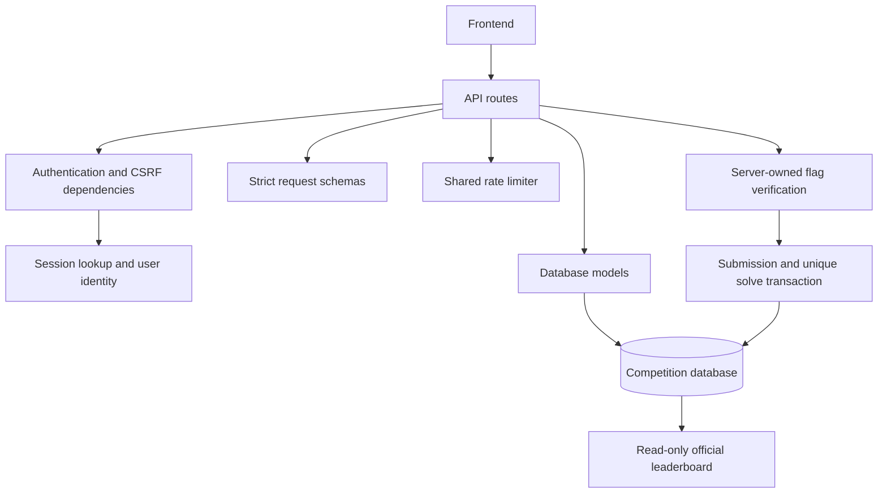

# Cryptum backend architecture

The protected competition API owns accounts, team membership, sessions, official submissions and scores. The vulnerable leaderboard and LLM challenge are separate services. They must not share the competition database credentials or flag master secret.

## File structure

```text
Codex-Cryptum-2026/
  README.md                 Existing repository introduction
  .gitignore                Excludes databases, credentials and environments
  backend/
    app/
      config.py             Environment configuration
      database.py           Database engine, sessions and base model
      models.py             Tables and database constraints
      schemas.py            API input validation; extra fields forbidden
      security.py           Password hashing, token hashing, flag derivation
      dependencies.py       Authentication, ownership identity, CSRF checks
      rate_limits.py        Shared atomic rate counters
      main.py               FastAPI assembly and middleware
      routes/
        auth.py             Login, identity, CSRF refresh and logout
        challenges.py       Challenge listing and flag submissions
        leaderboard.py      Read-only official score calculation
    tests/test_api.py       Security and scoring behavior tests
    manage.py               Local organizer commands
    start.ps1               Laptop startup
    requirements-lock.txt  Tested dependency versions
    README.md               Run instructions and frontend examples
  docs/
    architecture.md         Boundaries and integration contract
    schema.md               Entity relationships and data lifecycle
    schema.sqlite.sql       Generated schema for the laptop
    schema.postgresql.sql   Generated schema for a future deployment
```

Frontend and challenge-service directories can be added when their implementation starts. Empty placeholder services are not deployed.

## How the modules connect



The user-to-team relationship comes from the database, never from participant input. Official score is the sum of the immutable point awards stored on solves. Each accepted solve is unique for its team and challenge.

## Frontend API contract

| Method | Path | Authentication | Request / response |
|---|---|---|---|
| GET | /health | None | Basic liveness only |
| POST | /auth/login | Allowed Origin | username, password -> cookie and csrf_token |
| GET | /auth/me | Session | user_id, username, team_id |
| GET | /auth/csrf | Session | Rotates and returns csrf_token |
| POST | /auth/logout | Session + CSRF + Origin | Revokes session; 204 |
| GET | /challenges | Session | Public challenge fields and own team's solve state |
| POST | /challenges/{id}/submissions | Session + CSRF + Origin | flag -> correct, already_solved, awarded_points |
| GET | /leaderboard | Session | rank, team_id, team, score; up to 500 teams |

For browser requests use credentials: include. Keep the CSRF token in memory and send it as X-CSRF-Token on authenticated POST requests. Origin is supplied by the browser. ALLOWED_ORIGIN must exactly match the frontend's origin. See backend/README.md for a fetch example and complete PowerShell exercise.

## GitHub linking

The intended repository is D:\codex-cryptum\Codex-Cryptum-2026.

- origin: https://github.com/Jiyaa-codes/Codex-Cryptum-2026.git
- upstream: https://github.com/ayaankhatri/Codex-Cryptum-2026.git

The outer D:\codex-cryptum directory is also a Git repository, but has no remote. Always run Git inside the inner repository so the backend is added to the correct project. Existing remotes are preserved. No commit or push is made automatically by this setup.

Review from the inner folder with `git status --short` and open the new files in your editor. Use `git diff --cached` after staging if preferred. When ready, stage backend, docs and .gitignore; commit your reviewed changes, then push to origin on your chosen branch. Do not push to upstream unless the project owner has agreed.

## Next integration stages

1. Frontend login -> challenge list -> submission -> official standings.
2. Chat tables and routes: conversations must belong to a team; server chooses the model and system prompt. Add request/token budgets and a private inference endpoint.
3. Challenge provisioner: team-owned instances, scoped flags, expiry and reset. Run vulnerable services on a restricted network with separate data stores.
4. Public deployment: PostgreSQL integration tests, migrations, HTTPS, secure cookies, request-size limits, organizer MFA, account recovery, monitoring, backups and load tests.

This is a tested local starter, not a hardened public deployment. Database initialization uses create_all; versioned migrations are still required before schema evolution in production.
