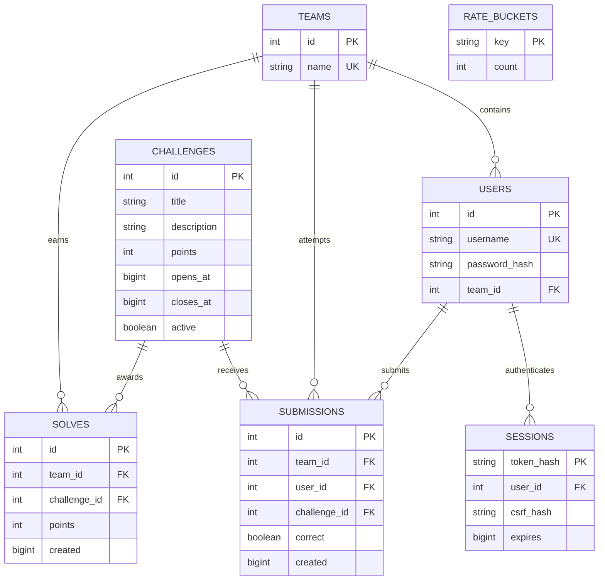

# Competition database schema

The SQL files beside this document are generated from the actual SQLAlchemy models. SQLite is the current local database; PostgreSQL is the future deployment target. Run manage.py init to create the local tables. Do not manually apply both SQL dialects to the same database.

Diagram timestamps represent Unix seconds; the current generated SQL stores Python int fields as INTEGER. Migrate timestamp fields to BIGINT or timezone-aware timestamps before long-term deployment beyond 2038.

| Table | Purpose | Important rule |
|---|---|---|
| teams | Scoring identity | Unique name; one-person teams work for individuals |
| users | Login and membership | Unique username; Argon2 password hash; organizer assigns team |
| sessions | Revocable login sessions | Only hashes of random cookie and CSRF tokens are persisted |
| challenges | Public metadata and availability | Server owns points and opening/closing times |
| submissions | Flag-attempt history | Never persist submitted plaintext flags |
| solves | Official scoring ledger | UNIQUE(team_id, challenge_id); points snapshot at solve time |
| rate_buckets | Cross-worker request counters | Atomic increment; periodic old-bucket cleanup still needed |

There is no mutable official leaderboard table. GET /leaderboard groups solves by team and sums points. Submission and solve are committed together; if two correct requests race, the unique database constraint permits only one award.

Flag verification derives CTF{HMAC-SHA256(secret, team_id + challenge_id)}. The secret lives outside the database. Each challenge instance receives only its own derived flag through a future trusted provisioner. No endpoint returns a flag. Local manage.py flag is an organizer test tool.

## Future entities, not implemented yet

- conversations(id, team_id, challenge_id, created_at)
- messages(id, conversation_id, role, content, created_at)
- challenge_instances(id, team_id, challenge_id, status, expires_at, internal_address)
- audit_events(id, actor_id, action, target, created_at)

These belong in later migrations after their lifecycle is specified. The vulnerable leaderboard gets its own database; never add its editable scores to this official scoring schema.
